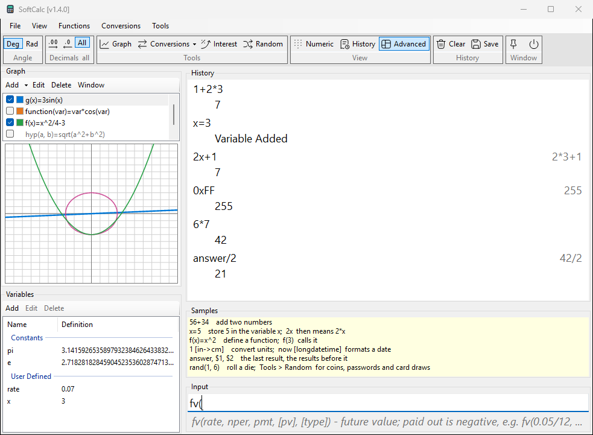
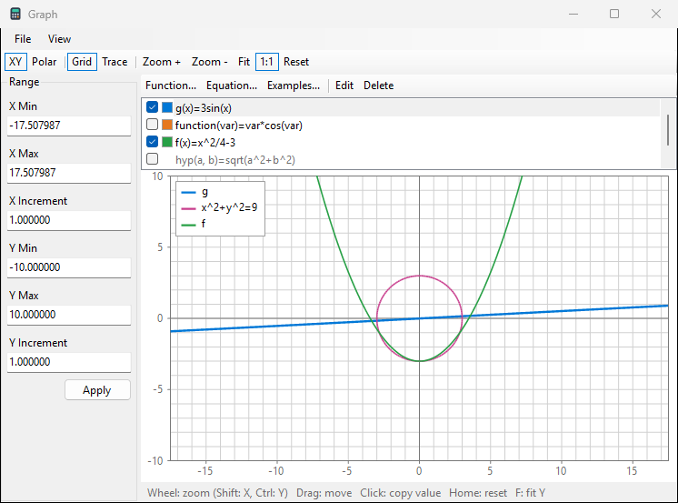

# SoftCalc

A free, expression-based calculator for Windows that behaves like the
"Calculator PowerToy" of Windows XP, with extras: graphs of functions
and equations, unit and currency conversions, dates, finance functions,
a customizable ribbon and built-in help.

<p>
  
  
</p>

Type an expression, press Enter, and the line and its result go to the
History:

```
2^3^2                     512
f(x)=x^2-2                (defines a function)
f(3)                      7
1 [ft->in]                12
100 [usd->thb]            (ECB rates of the day)
now [longdatetime]        (today's date and time)
fv(0.05/12, 120, -100)    15528.227944566792820456167703351
```
## Features

- High precision (mpmath), up to 512 digits; complex
  numbers; decimal, hex, binary and octal output; `twos(x)` and
  `signed(x)` for a chosen word size.
- Variables and user functions, `answer` and `$1`, `$2` for earlier
  results; RPN mode.
- Unit conversions (length, mass, time, velocity, area with Thai
  rai-ngan-wa, temperature, time zones) and currency conversion with ECB reference
  rates, cached for offline use.
- Dates and durations: `now`, date formats, `[utc->local]`, `h:mm:ss`.
- Finance: `fv`, `pv`, `pmt`, `nper`, and a Compound Interest
  window with a growth graph and period table.
- Graph: functions of one parameter and equations in x and y such as
  `x^2+y^2=r^2`; zoom, pan, 1:1 scale, trace at full precision, line
  colours, polar mode, and a gallery of classic curves with their
  constants explained.
- Views: Numeric Calc, History View, Advanced View (with Graph and
  Variables panels); light and dark theme; text size.
- Random: `rand()` and seeds in any line, numbers in a shape
  (`randbeta`, `randtri`, ...), and a Random window with lists, coins,
  dice, shaped draws, passwords, an entropy lab (system, TPM, timing,
  mouse, dice, and two public beacons fetched only when you ask), and
  draws from card decks of your own or ready-made ones (playing cards,
  months, provinces of Thailand, countries...): weights, conditions
  between steps, and a slot machine, dartboard or spin wheel to watch.
- Customize Ribbon: put any menu command on the ribbon, with your own
  SVG icons, spaces and separators.
- Help inside the program (File > Help, or F1 in any window).

## Download

Get the latest version from
[Releases](https://github.com/tuinui98/SoftCalc/releases). Two Windows
x64 builds:

| file | size | needs |
|---|---|---|
| `SoftCalc.exe` | about 60 MB | nothing: .NET and the Python engine are inside |
| `SoftCalc-net10.exe` | about 10 MB | the [.NET 10 Desktop Runtime](https://dotnet.microsoft.com/download/dotnet/10.0) (x64) |

Put the exe in any folder and run it; there is no installer. SoftCalc
keeps its data (settings, history, functions, rates) in `SoftCalc-data\`
beside the exe when that folder is writable, else in
`%APPDATA%\SoftCalc`.

The exes are not code-signed, so Windows SmartScreen or an antivirus may
warn on the first start.

## Building from source

Needs Windows, Python 3.14 or newer, and the .NET 10 SDK.

Engine (from `engine/`):

```
python -m venv .venv
.venv/Scripts/python -m pip install -e ".[dev]"
.venv/Scripts/python -m pytest -q
```

UI (from `ui/`; finds the engine in `engine/.venv` during development):

```
dotnet build
dotnet test
dotnet run --project SoftCalc
```

Release build (both exes in `dist\`, smoke-tested):

```
powershell -ExecutionPolicy Bypass -File build\publish.ps1
```

## How it is built

Two processes talking JSON lines over stdin/stdout:

- `engine/` - Python + mpmath: parser (infix and RPN), evaluation,
  number formatting, units, dates, finance, graph sampling. No file or
  network access of its own. Protocol: `design/protocol.md`.
- `ui/` - C# WinForms on .NET 10: windows, settings and history files,
  graph drawing, the ECB rate download, engine watchdog.

Other folders: `help/` (the help topics and their pictures), `spec/`
(the behaviour contract and test data), `design/` (plans and status),
`tools/` (help pictures, icon, notices, UI test drivers), `build/`
(release scripts).

## Clean room

SoftCalc was written from scratch. The original program's behaviour was
learned only by using it as a black box: its windows, its answers and
the files it writes. No code of it was disassembled or decompiled, and
none of its icons, pictures or help text are used. SoftCalc is not
affiliated with or endorsed by Microsoft; "Windows" and "PowerToys" are
trademarks of Microsoft Corporation.

## Feedback

Bug reports and ideas are welcome as
[issues](https://github.com/tuinui98/SoftCalc/issues). Pull requests are
not accepted: this is a clean-room project, and outside code cannot be
checked for that.

## Licence

SoftCalc is under the [MIT licence](LICENSE). It uses mpmath (BSD 3-Clause),
the .NET runtime (MIT), the PyInstaller bootloader (GPL 2 with the
Bootloader Exception) and IconMCP icons (MIT); their notices are in
[ui/SoftCalc/THIRD-PARTY-NOTICES.txt](ui/SoftCalc/THIRD-PARTY-NOTICES.txt)
and in the program's About box.
