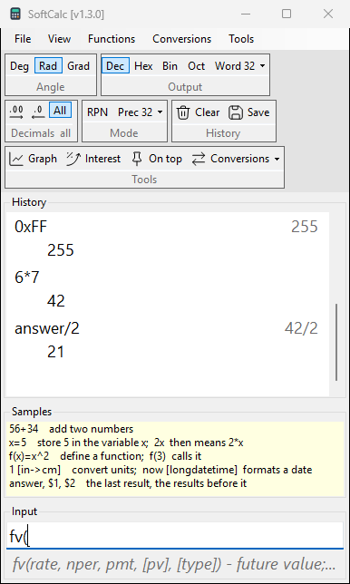

# Getting started

Type a calculation in the **Input** box and press **Enter**. The line
and its result go to **History**; the Input box clears for the next line.



```calc
1+2*3                 => 7
0.1+0.2               => 0.3
2^100                 => 1267650600228229401496703205376
```

SoftCalc works in decimal at the precision you choose (View > Advanced
Options), so `0.1+0.2` is exactly `0.3`, and big numbers keep every digit
the precision allows.

## History

Each entry shows what you typed on the left. When the line uses names or
earlier results, the numbers it used are shown faint on the right, and
the result is on the line below.

- **Click** an entry to put its line back in Input.
- **Shift+click** inserts the entry's result at the caret.
- **Right-click** for Use Expression, Insert Result, Copy Result,
  Copy Expression and Result, Copy All, Delete and Clear History.

An error keeps your text in Input, so you can fix it. The History line
shows what went wrong, for example `ERROR:Expected ')'`.

## Earlier results

```calc
6*7                   => 42
answer/2              => 21
$2+1                  => 43
```

- `answer` (or `ans`) is the last result.
- `$1` is the last result too, `$2` the one before, and so on. Only
  results count; definitions and errors are skipped. After a Delete the
  numbers close up.
- Typing an operator into an empty Input starts with the last result:
  press `*` and Input reads `answer*`.

## Keys in the Input box

| key | does |
|---|---|
| Enter | calculate the line |
| Enter on an empty Input | repeat the last History line (`answer*2` doubles again) |
| Up / Down | step through lines typed before; Down past the newest brings back your draft |

## The hint line

The faint line under Input explains what is left of the caret:

- the function you are typing, with its arguments: typing `fv(` shows
  `fv(rate, nper, pmt, [pv], [type]) - future value; ...`
- names that start with what you typed, after two letters
- tag examples inside an open `[`
- a number typed in another base, shown in the output base: `0xFF`
  shows `255` when the output is decimal

Turn it off with View > Show Input Hints.

## Views

View > Numeric Calc, History View and Advanced View change the layout.
Advanced View adds the Graph and Variables side panel. View > Show Samples
shows a pane of short examples (not in Numeric Calc).

## Help

File > Help or **F1** opens this Help; F1 in the Graph, Compound
Interest, Functions or Customize Ribbon window opens its own topic.
Click an example line to put it in Input. Search finds the topics that
hold every word you type.

The title bar shows the version, such as `SoftCalc [v1.3.0]`; File >
About SoftCalc... shows it too, with the data folder and the licences.
