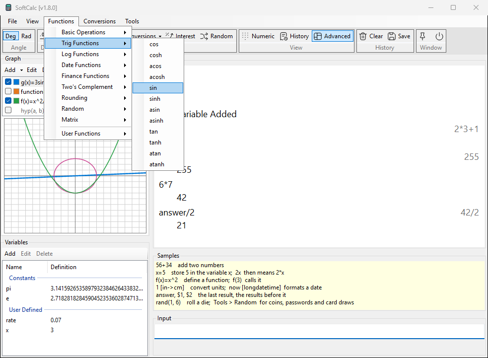

# Functions

## From the Functions menu

<!-- desktop -->
The **Functions** menu lists every built-in function by group. Picking one:
<!-- /desktop -->

<!-- web -->
The **func** key (Sci keys), or ⋮ > Functions, lists every built-in
function by group. Picking one:
<!-- /web -->

- puts its name and an opening bracket at the caret: with `2*` in Input,
  Functions > Basic Operations > sqrt gives `2*sqrt(`; type the argument
  and close it with `)`;
- an operator (`+`, `^`, `mod`, `!`, ...) is put at the caret too.

<!-- desktop -->


User Functions, at the bottom, lists the functions you defined
(section *Variables and user functions*).
<!-- /desktop -->

<!-- web -->
Your functions, at the top, lists the functions you defined
(section *Variables and user functions*).
<!-- /web -->

## Maths

```calc
sqrt(2)               => 1.4142135623730950488016887242097
abs(-7)               => 7
exp(1)                => 2.7182818284590452353602874713527
ln(100)               => 4.6051701859880913680359829093687
log10(1000)           => 3
```

| group | functions |
|---|---|
| Basic Operations | `sqrt` `abs`, and the operators `+ - * / ^ mod ! %` |
| Trig Functions | `sin cos tan`, `asin acos atan`, `sinh cosh tanh`, `asinh acosh atanh` |
| Log Functions | `exp` `ln` `log10` |
| Date Functions | `epoch fromepoch longdate longtime longdatetime` (section *Dates and time*) |
| Finance Functions | `fv pv pmt nper` (section *Finance*) |
| Two's Complement | `twos` `signed` |
| Rounding | `round` `ceil` `floor` |
| Random | `rand` `rands` `randbeta` `randtri` `randexp` `randpeaks` `card` (section *Random*) |
| Matrix | lists and matrices: `det` `inv` `solve` `sum` `mean` `fill` `seq` and more (section *Lists and matrices*) |

## Angles

`sin`, `cos` and `tan` read their argument in the angle unit, and `asin`,
`acos`, `atan` answer in it.

<!-- desktop -->
Pick the unit with the ribbon's **Angle**
group (Deg / Rad) or View > Advanced Options > Degrees / Radians /
Grads. SoftCalc starts in degrees. Hyperbolic functions do not use it.
<!-- /desktop -->

<!-- web -->
Pick the unit with the **deg ▸** key or Settings > Angle (deg, rad,
grad). SoftCalc starts in degrees. Hyperbolic functions do not use it.
<!-- /web -->

```calc
sin(pi/6)             => 0.5
```

The line above is in radians; in degrees (the start) write `sin(30)`.

- A pole is an error, not a huge number: `tan(90)` in degrees,
  `ln(0)`, `1/0`.
- Functions accept complex numbers: `sqrt(-1)` is `1i`, `ln(-1)` is
  `3.14...i`.

## Two's complement

`twos(x, bits)` gives the bit pattern that stores a signed value;
`signed(x, bits)` reads a pattern back as signed.

```calc
twos(-1, 8)           => 255
signed(0xFF, 8)       => -1
twos(300, 8)          => 44
```

<!-- desktop -->
- Without `bits`, View > Word Size (8, 16, 32 or 64 bits, also on the
  ribbon, see *Ribbon*) is used.
<!-- /desktop -->

<!-- web -->
- Without `bits`, Settings > Word size (8, 16, 32 or 64 bits) is used.
<!-- /web -->
- A value outside the word wraps, like hardware: `twos(300, 8)` is 44.
- History adds the result in hex on the right: `twos(-1)` shows
  `twos(-1, 32) = 0xFFFFFFFF`.

## Rounding

`round(x)` rounds half away from zero; `round(x, digits)` keeps that
many decimal places (a negative count rounds to tens, hundreds, ...).
`floor(x)` goes down to a whole number, `ceil(x)` up.

```calc
round(2.5)            => 3
round(-2.5)           => -3
round(3.14159, 2)     => 3.14
round(1234, -2)       => 1200
floor(-1.2)           => -2
ceil(1.2)             => 2
```

A value only a hair off a whole number from binary rounding counts as
that number: `floor(0.1*30)` is 3.

## Cards from a deck

`card("deck")` draws a card from one of your decks or a ready-made
deck, by weight. `card("deck", count)` draws several, and
`card("deck", count, 1)` draws them with no card twice.

```calc
card("Months")
card("เดือน", 3)
card("Playing cards", 5, 1)
card("Dice")*10
```

- The deck's name goes in quotes, in any case; a ready-made deck has an
  English and a Thai name, and the cards come in the language of the
  name you type: `card("Months")` gives March, `card("เดือน")` มีนาคม.
- Cards saved to start unticked (the two jokers) are left out; the
  ticks and piles of the Random window are not used.
- A card named like a number gives that number, so it can go on into a
  sum: a deck `Dice` of the cards 1 to 6 makes `card("Dice")*10` 10 to
  60. Other cards give their name.
- Several numbers come as a list such as `[3, 5, 1]`, which a variable
  or `$n` can keep; several names as `Rice, Soup, Rice`.
- `rands(seed)` makes card draws repeat too.
- History shows the cards drawn on the right, as with `rand()`.
<!-- desktop -->
- **Insert Command** in the Random window puts the line in Input for
  you (see *Random*).
<!-- /desktop -->
<!-- web -->
- **Insert command** on Random > Cards puts the line for the deck,
  Count and No repeat in Input.
<!-- /web -->
