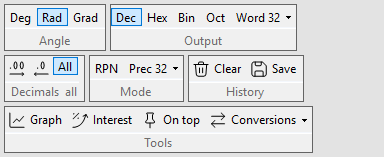

# Display and precision

Two separate things decide what a result looks like:

- **Precision**: how many significant digits SoftCalc calculates with.
- **Decimal places**: how many digits after the point are shown. The
  stored value keeps full precision.

## Precision

<!-- desktop -->
View > Advanced Options (Customize Ribbon can add a **Prec** button,
see *Ribbon*):

| choice | digits |
|---|---|
| Low Precision | 32 |
| Medium Precision | 64 |
| High Precision | 128 |
| Extreme Precision | 512 (slow) |
<!-- /desktop -->

<!-- web -->
Settings > Precision: 32, 64, 128 or 512 (slow) significant digits.
<!-- /web -->

A result with more digits than the precision allows is written in
scientific form: `2^200` at 32 digits is
`1.6069380442589902755419620923412e60`.

## Decimal places

<!-- desktop -->


Ribbon **Decimals** group, or View > Decimal Places:

- **More** / **Fewer** (the `.00` buttons) step the places from 0 to 30;
  from All they start at 2;
- **All** shows every digit the precision gives (the default);
- **Pad with Zeros** writes `2.50` instead of `2.5`.

The group's caption shows the current setting, such as `0.00` or `all`.
<!-- /desktop -->

<!-- web -->
Settings > Decimals:

- **−** / **+** step the places from 0 to 30; from all they start at 2;
- **all** shows every digit the precision gives (the default); the
  count then reads `*`;
- Settings > Pad zeros writes `2.50` instead of `2.5`.
<!-- /web -->

Decimal places round half away from zero and apply to decimal output
only.

## Output base

<!-- desktop -->
View > Hexadecimal / Decimal / Octal / Binary Output (Customize Ribbon
can add Dec, Hex, Bin and Oct buttons):
<!-- /desktop -->

<!-- web -->
Settings > Output base, or the **dec ▸** key (each tap: dec, hex, oct,
bin):
<!-- /web -->

```calc
255                   => 255
```

The same `255` reads `0xFF` in hex, `0o377` in octal and `11111111b` in
binary. Fractions work too: `3.5` in hex is `0x3.8`.

When you type a number in another base than the output, History shows
it converted on the right, faint (`0x1F+1` shows `31+1`), and so does
the hint line while you type.

## Settings typed in Input

A line that starts with `:` changes settings instead of calculating:

```calc
:deg :prec 64         => Degrees, Precision 64
sin(30)               => 0.5
:hex                  => Hexadecimal
255                   => 0xFF
:dec :digits 2 :pad   => Decimal, 2 decimal places, Pad zeros on
2.5                   => 2.50
:digits all :pad off  => All digits, Pad zeros off
:prec 100             => ERROR:Precision is 32, 64, 128 or 512
```

| setting | type |
|---|---|
| angle | `:deg` `:rad` `:grad` |
| output base | `:dec` `:hex` `:bin` `:oct` |
| precision | `:prec 32`, `64`, `128` or `512` |
| decimal places | `:digits 0` to `512`, or `:digits all` |
| pad with zeros | `:pad on` / `:pad off` |
| RPN mode | `:rpn on` / `:rpn off` (or `:infix`) |
| word size of `twos` and `signed` | `:word 8`, `16`, `32` or `64` |

- Full names work too: `:degrees`, `:hexadecimal`, `:precision 64`,
  `:decimals 2`, `:wordsize 16`, and `=` in place of the space
  (`:prec=64`). Letter case does not matter.
- Several on one line apply together; if one is wrong, none of them
  changes and the error says what it takes.
- A setting typed is kept like one picked from the menus, and the
  menus and buttons show it at once.
- The line is not a result: it leaves `answer` and `$1` as they were.
- `:` alone lists every setting as the line that sets them all again,
  such as `:prec 32 :rad :dec :rpn off :digits all :pad off :word 32`;
  copy it to put the same settings back later.
- While you type, the hint line lists the commands, then what a command
  takes (`:prec` shows `32 64 128 512`).
