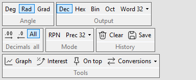

# Display and precision

Two separate things decide what a result looks like:

- **Precision**: how many significant digits SoftCalc calculates with.
- **Decimal places**: how many digits after the point are shown. The
  stored value keeps full precision.

## Precision

View > Advanced Options, or the ribbon's **Prec** button in the Mode
group:

| choice | digits |
|---|---|
| Low Precision | 32 |
| Medium Precision | 64 |
| High Precision | 128 |
| Extreme Precision | 512 (slow) |

A result with more digits than the precision allows is written in
scientific form: `2^200` at 32 digits is
`1.6069380442589902755419620923412e60`.

## Decimal places



Ribbon **Decimals** group, or View > Decimal Places:

- **More** / **Fewer** (the `.00` buttons) step the places from 0 to 30;
  from All they start at 2;
- **All** shows every digit the precision gives (the default);
- **Pad with Zeros** writes `2.50` instead of `2.5`.

The group's caption shows the current setting, such as `0.00` or `all`.
Decimal places round half away from zero and apply to decimal output
only.

## Output base

Ribbon **Output** group, or View > Hexadecimal / Decimal / Octal /
Binary Output:

```calc
255                   => 255
```

The same `255` reads `0xFF` in hex, `0o377` in octal and `11111111b` in
binary. Fractions work too: `3.5` in hex is `0x3.8`.

When you type a number in another base than the output, History shows
it converted on the right, faint (`0x1F+1` shows `31+1`), and so does
the hint line while you type.
