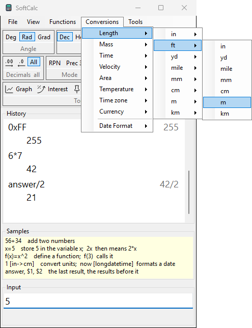

# Unit conversions

Put a tag `[from->to]` after a value:

```calc
1 [ft->in]            => 12
100 [km/h->m/s]       => 27.777777777777777777777777777778
37 [c->f]             => 98.6
1 [ft->in] [in->cm]   => 30.48
1 [ft->in]+1          => 13
```

- The tag converts everything to its left: `2*3 [ft->in]` is 72.
- Tags chain, and the line can go on after a tag.
- Upper or lower case and a space before `[` do not matter.
- Units from different groups do not mix: `[m2->ft]` is an error.

## With the menu

You do not need to remember unit names:

1. Type the value, for example `5`.
2. Open **Conversions**, pick the group, the unit you have, then the unit
   you want: Conversions > Length > ft > m.
3. Input now reads `5 [ft->m]`; press Enter.



The ribbon's **Conversions** button (Tools group) opens the same menu.
A conversion you use often can get its own ribbon button
(section *Ribbon*).

## Units

| group | units |
|---|---|
| Length | `in ft yd mile mm cm m km` |
| Mass | `lb oz g kg` |
| Time | `yr mo wk d h min s` |
| Velocity | `mi/h m/s ft/h km/h knot` |
| Area | `mm2 cm2 m2 ha km2 in2 ft2 yd2 acre mi2 wa2 ngan rai rnw` |
| Temperature | `c f k` |
| Time zone | `utc local` (section *Dates and time*) |
| Currency | ISO codes such as `usd thb eur` (section *Currency*) |

- Inside a tag, long names work for time (`[hours->minutes]`) and
  some area units (`sqft`, `m^2`, `hectare`, `acres`, `sqwa`).
- A year is 365 days and a month 30 days.
- Factors are the exact international ones: 1 in = 2.54 cm,
  1 lb = 0.45359237 kg.

## Thai land area: rai-ngan-wa

1 rai = 4 ngan = 400 square wa = 1600 m2.

```calc
6800 [m2->rnw]        => 4.25
4-1-50 [rnw]          => 4.375
4-1-50 [rnw->m2]      => 7000
4-1-50[rnw]+0-2-400[rnw]   => 5.875
```

- `rnw` as a number is rai: `6800 [m2->rnw]` is 4.25 rai, and History
  shows `= 4-1-0` on the right.
- Type a plot as `rai-ngan-wa` followed by an rnw tag: `4-1-50 [rnw]` is
  4 rai, 1 ngan and 50 square wa. Ngan and wa may be larger than one
  rai or ngan (`0-2-400`).
- `[rnw]` alone keeps the unit, so plots add up: the last line above
  shows `= 5-3-50`.
- The tag must come right after the three numbers. Without it, `-` is
  minus: `4-1-50` alone is -47. The hint line shows how the group is
  read: `4-1-50 = 4.375 rai`.
- The wa part follows Decimal places.
