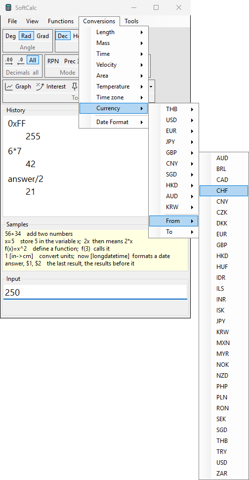

# Currency

```calc
100 [usd->thb]
1000 [thb->usd]
```

Currency tags work like unit tags, with ISO codes: `usd`, `thb`, `eur`,
`jpy`, `gbp`, and about 30 more. Each line shows the rate date faint on
its result line, for example `ECB 2026-11-05`.

## Rates

- Rates are the European Central Bank's daily reference rates; other
  pairs are worked out through the euro.
- SoftCalc fetches them only when you calculate a currency line, and
  only when a newer publication may exist. The ECB publishes once per
  working day, around 16:00 Central European Time.
- The rates are kept in the data folder, so currency lines work offline
  with the last rates; the note then ends in `, offline`.
- Before the first fetch there are no rates: without internet a currency
  line gives `Currency rates unavailable`.
- This is the only time SoftCalc uses the internet.
- A code the ECB does not publish gives `No ECB rate for ...`.

## With the menu

Conversions > Currency lists common pairs (THB, USD, EUR, JPY, GBP, CNY,
SGD, HKD, AUD, KRW). For any other pair use the two halves:

1. Type the amount: `250`.
2. Conversions > Currency > From > CHF: Input reads `250 [CHF`.
3. Conversions > Currency > To > THB: Input reads `250 [CHF->THB]`.


