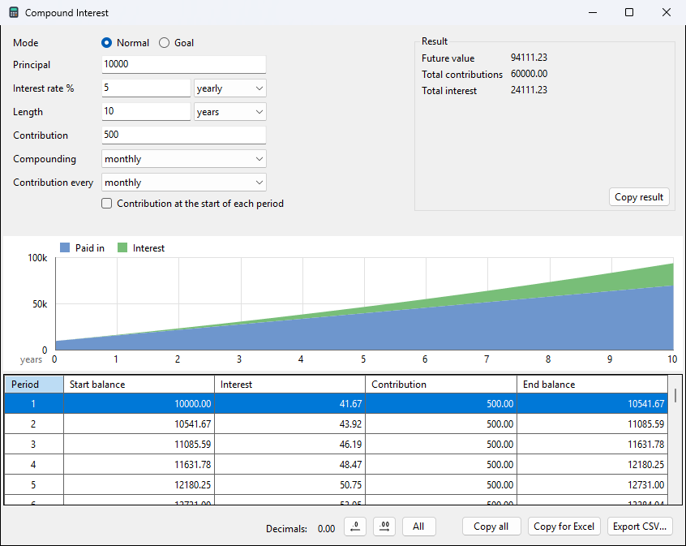

# Finance

## Functions

The same functions as in spreadsheets, with the rate **per period**:

| function | gives |
|---|---|
| `fv(rate, nper, pmt, [pv], [type])` | value at the end |
| `pv(rate, nper, pmt, [fv], [type])` | value today |
| `pmt(rate, nper, pv, [fv], [type])` | payment per period |
| `nper(rate, pmt, pv, [fv], [type])` | number of periods |

- Money you pay out is negative, money you receive is positive.
- `type` 1 means payments at the start of each period; 0 (the default)
  at the end.
- For a yearly rate paid monthly, divide by 12 and count months.

```calc
fv(0.05/12, 120, -100)        => 15528.227944566792820456167703351
pmt(0.06/12, 360, 3000000)    => -17986.515754582571837743837310534
nper(0.01, -500, 10000)       => 22.42574187803646223120137896696
```

- Saving 100 a month for 10 years at 5% a year gives 15528.23.
- A 3,000,000 loan over 30 years at 6% costs 17986.52 a month.
- Paying 500 a month on a 10,000 debt at 1% a month clears it in
  22.43 months, so 23 payments.

<!-- desktop -->
## Compound Interest window

Tools > Compound Interest... (ribbon: **Interest**) works out savings
without formulas.



- **Normal** works out what the money grows to. Fill in Principal,
  Interest rate %, Length and, if you add money regularly,
  Contribution, Contribution every, and whether it comes at the start
  of each period. Each box takes any expression, such as `120000/12`;
  one SoftCalc cannot read says why beside it.
- Compounding and Contribution every: yearly, quarterly, monthly,
  weekly or daily (compounding also continuous).
- The rate is per year, month, week or day, and the length is in years,
  months, weeks or days (the graph's x axis follows it). A year is 365
  days, a month a twelfth of it, a week 7 days. Compounded less often
  than the rate's unit, the rate compounds: 0.1% a day, yearly, is
  1.001^365 - 1 a year, not 36.5%. A part period is cut: 100 days,
  monthly, is 3 months.
- The result updates as you type: the totals, a growth graph and a
  table by period. Drag the line between the graph and the table to
  share the height.
- **Decimals** sets the places of the table, the totals and a worked-out
  value, for this window only: fewer, more (from All both start at 2),
  or All. It shows as a sample, `0.00`, and as a number past 5.
- **Copy result** copies the Result box's lines; **Copy all** and
  **Export CSV...** the table (the name carries the date and time, such
  as `SoftCalc-compound-2026-11-20-1530.csv`); Ctrl+C the selected rows.
- **Copy for Excel** copies it all as a sheet: paste it at A1 of an
  empty sheet (Excel, OnlyOffice, Google Sheets; LibreOffice asks, tick
  Evaluate formulas). The inputs, the totals and every row are
  formulas, so changing an input there works it out again. The rows
  stay as many as here, and the cells keep the General format. A
  computer set to a decimal comma reads the formulas wrong.
- A long table fills in the background, so the window opens at once.
- The window remembers what you typed last time.

### Goal

**Goal** takes four of Target, Principal, Interest rate, Length and
Contribution and works out the fifth: the one set longest ago. Typing
in a field, or changing its unit, sets it; typing in the worked-out one
sets it too, and the next oldest is worked out instead. The order is
kept for next time.

```
Target 10000000, Interest rate 0.5 % monthly, Length 20 years,
Contribution 15000 a month: Principal is worked out
then Principal 50000: Target is worked out (set longest ago)
then Target 10000000: Length is worked out
```

- The worked-out field is in bold with `= result` beside it; the Result
  box lists it first, then the others from the one set last to the one
  set longest ago, then the totals.
- The rate's unit is the compounding: 0.5 % monthly compounds each
  month, so there is no Compounding field.
- A worked-out length may end in a part period: 1000 at 10% a year to
  2000 takes 7.27 years, shown also as `7 y 3 m 8 d`, and the table's
  last row is `8 (0.2725)`, interest for that share of a year. A length
  you give may end in a part period too.
- A worked-out value shows in the window's places but keeps every
  digit, so setting another field later does not round it.
- Some goals cannot be met, such as a length with no interest and no
  contribution, or a rate for a target below zero; the field says why.
- In Copy for Excel a worked-out Target is a formula; another
  worked-out field is SoftCalc's number, and **End balance - target**
  shows how far a changed sheet is from the target (Excel's Goal Seek
  can find it again).
<!-- /desktop -->

<!-- web -->
## Compound

⋮ > Compound works out savings without formulas.

- **Normal** works out what the money grows to. Fill in Principal,
  Interest rate %, Length and, if you add money regularly,
  Contribution, Contribution every, and whether it comes at the start
  of each period. Each box takes any expression, such as `120000/12`;
  one SoftCalc cannot read says why under it.
- Compounding and Contribution every: yearly, quarterly, monthly,
  weekly or daily (compounding also continuous).
- The rate is per year, month, week or day, and the length is in years,
  months, weeks or days (the graph's x axis follows it). A year is 365
  days, a month a twelfth of it, a week 7 days. Compounded less often
  than the rate's unit, the rate compounds: 0.1% a day, yearly, is
  1.001^365 - 1 a year, not 36.5%. A part period is cut: 100 days,
  monthly, is 3 months.
- The result updates as you type: the totals, then a chart or a table.
  Tap a total to put it in Input; **Copy result** copies them all.
- **Chart** shows the money paid in below and the interest above, so
  the top edge is the balance; drag a finger along it to read a period.
  **Table** lists every period, and sets its places for this page:
  fewer, more (from All both start at 2), or All, shown as a sample,
  `0.00`. The places go for the totals too.
- **CSV** saves the table, as the desktop's Export CSV; **PNG** saves
  the chart with a line saying what it is; **Copy** copies that line.
  Files are named with the date and time, such as
  `SoftCalc-compound-2026-11-20-1530.csv`: in the app in
  Download/SoftCalc, in a browser in its downloads.
- **Excel** copies it all as a sheet: paste it at A1 of an empty sheet
  (Excel, OnlyOffice, Google Sheets; LibreOffice asks, tick Evaluate
  formulas). The inputs, the totals and every row are formulas, so
  changing an input there works it out again. The rows stay as many as
  here, and the cells keep the General format.
- **Goal** takes four of Target, Principal, Interest rate, Length and
  Contribution and works out the fifth, the one set longest ago; typing
  in a field or changing its unit sets it. The worked-out field shows
  `= result`, and comes first in the totals, then the others from the
  one set last. The rate's unit is the compounding. A worked-out length
  may end in a part period (`7 y 3 m 8 d`, the last row `8 (0.2725)`).
  In Excel a worked-out Target is a formula; another worked-out field is
  a number, with an **End balance - target** check.
- A long table fills in the background.
- Compound remembers what you typed last time.
<!-- /web -->
