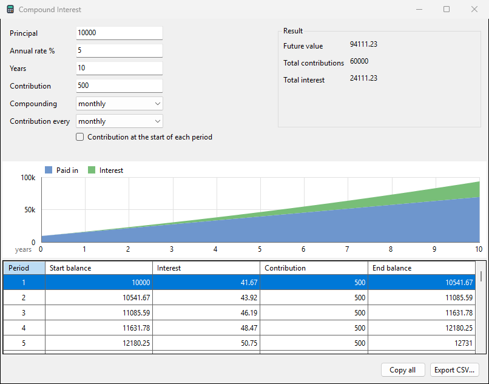

# Finance

## Functions

The same functions as in spreadsheets, with the rate **per period**:

| function | gives |
|---|---|
| `fv(rate, nper, pmt, [pv], [type])` | value at the end |
| `pv(rate, nper, pmt, [fv], [type])` | value today |
| `pmt(rate, nper, pv, [fv], [type])` | payment per period |
| `nper(rate, pmt, pv, [fv], [type])` | number of periods |

- Money you pay out is negative, money you receive is positive.
- `type` 1 means payments at the start of each period; 0 (the default)
  at the end.
- For a yearly rate paid monthly, divide by 12 and count months.

```calc
fv(0.05/12, 120, -100)        => 15528.227944566792820456167703351
pmt(0.06/12, 360, 3000000)    => -17986.515754582571837743837310534
nper(0.01, -500, 10000)       => 22.42574187803646223120137896696
```

- Saving 100 a month for 10 years at 5% a year gives 15528.23.
- A 3,000,000 loan over 30 years at 6% costs 17986.52 a month.
- Paying 500 a month on a 10,000 debt at 1% a month clears it in
  22.43 months, so 23 payments.

## Compound Interest window

Tools > Compound Interest... (ribbon: **Interest**) works out savings
without formulas.



- Fill in Principal, Annual rate %, Years and, if you add money
  regularly, Contribution, Contribution every, and whether it comes at
  the start of each period.
- Compounding: yearly, quarterly, monthly, daily or continuous.
- The result updates as you type: future value, total contributions,
  total interest, a growth graph and a table by period.
- Copy all and Export CSV... take the table; Ctrl+C copies the selected
  rows.
- The window remembers what you typed last time.
