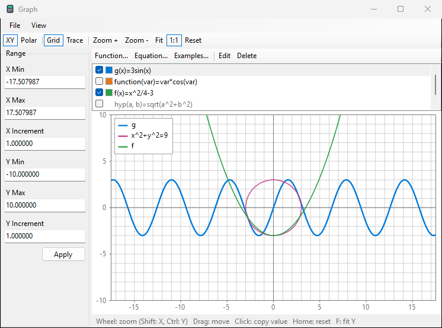
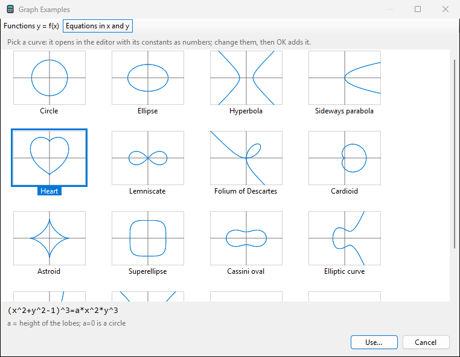
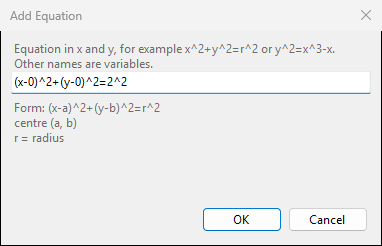

# Graph

SoftCalc draws functions with one parameter, and equations in `x` and
`y`.

- In **Advanced View**, the Graph panel on the left shows a small graph.
- **Tools > Graph...** (ribbon: **Graph**, or **Window** in the Graph
  panel) opens the Graph window, with zoom, trace and ranges.

## Adding lines

In the Graph panel or the Graph window:

- **Function...** opens the Functions editor: define for example
  `f(x)=x^2-2`. A function with one parameter is drawn.
- **Equation...** takes an equation in `x` and `y`, such as `x^2+y^2=9`
  or `y^2=x^3-x`. Other names in it are variables, read when the line
  is drawn, so `x^2+y^2=r^2` follows `r`.
- **Examples...** shows classic curves, each with a small graph:
  parabola, sine, bell curve, circle, heart, lemniscate and more. Under
  the pictures are the curve's form with its constants, such as
  `(x-a)^2+(y-b)^2=r^2`, and what each constant changes.

Pick one with **Use...** or a double-click. It opens in the Functions
editor or Add Equation with the constants written in as numbers, such
as `(x-0)^2+(y-0)^2=2^2`; the form and the note stay in grey under the
input. Change the numbers if you like, then OK adds the line.

In the narrow Graph panel of Advanced View the buttons wrap to a second
row.

The list shows every line with a tick box and a colour square:

- tick a line to draw it; the selected one is drawn thicker;
- click the colour square to pick another colour;
- right-click a line for Colour..., Default Colour, Edit... and Delete;
- double-click edits.

Functions with more than one parameter are listed greyed out.

## Moving around (Graph window)

| do | how |
|---|---|
| zoom around the mouse | mouse wheel, or + and - |
| zoom x only / y only | Shift+wheel / Ctrl+wheel |
| move | drag, or the arrow keys |
| fit y to the lines | **Fit**, F or Ctrl+F |
| same scale on x and y | **1:1** |
| back to the start range | **Reset**, Home |

- **1:1** makes one unit as long across as up, so circles are round.
  It stays on (button pressed) while you zoom and move; a one-axis zoom,
  Fit, Reset or a typed range turns it off.
- The **Range** panel shows the numbers and takes typed ones: enter X
  Min, X Max, Y Min, Y Max and the grid increments, then **Apply**.
- **Polar** draws `r = f(theta)`; **XY** goes back. **Grid** shows or
  hides the grid.
- File > Save as bitmap... saves the picture.
- The window opens at its last size and place.

## Trace

With **Trace** on, a dot follows the line nearest the mouse and the
status line shows its value at full precision, such as
`g(1.43) = 2.0449`.

- Click copies the value.
- Right-click: copy or insert into Input. On an equation you can take
  x, y or the pair `(x, y)`.
- On an equation, SoftCalc keeps x where the line is flat and y where
  it is steep, and solves for the other.
