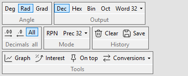
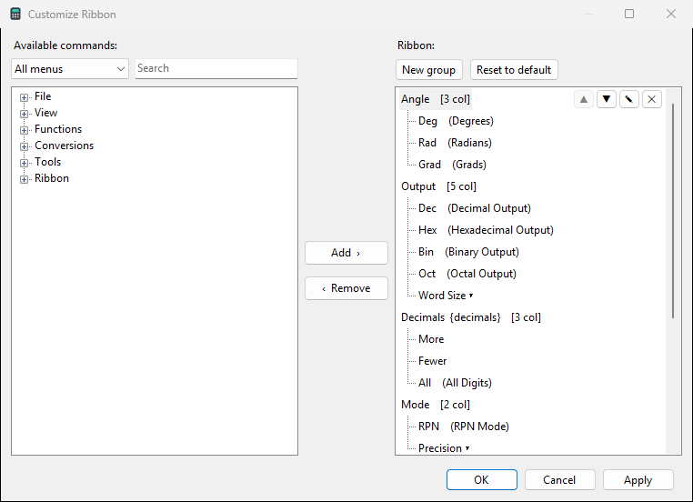

# Ribbon

The ribbon is the row of buttons under the menu bar. Every button runs
a menu command, so anything you can do from a menu can have a button.

| group | buttons |
|---|---|
| Angle | Deg, Rad, Grad |
| Output | Dec, Hex, Bin, Oct, Word size |
| Decimals | more, fewer, All |
| Mode | RPN, Prec (precision) |
| History | Clear, Save |
| Tools | Graph, Interest, On top, Conversions |

View > Show Ribbon hides or shows it. Numeric Calc never shows it.

## Customize Ribbon

View > Customize Ribbon..., or right-click the ribbon.

- **Left**: every command, in menu order. Filter by menu or search by
  name. Each function, unit pair and user function is a command.
- **Right**: the ribbon's groups and their buttons.

To change it:

- **Add** (or double-click, or Enter) puts the command after the
  selected button, or at the end of the selected group.
- **Drag** commands from the left into place; drag buttons and groups
  to move them; drag a button to the left list to remove it.
- The selected row has **Up**, **Down**, **Edit** and **Remove**
  buttons (Ctrl+Up, Ctrl+Down, F2, Delete).
- **Edit** on a button: its label, and whether it shows icon and text,
  icon only or text only.
- **Edit** on a group: its caption and how many columns it has. In a
  caption, `{decimals}` shows the current decimal places.
- **New group** adds a group; **Reset to default** brings back the
  ribbon above.
- **Apply** shows the change and keeps the window open; **OK** applies
  and closes; **Cancel** goes back to how it was.

A button for a user function you delete is hidden, and comes back if
you define the function again.
