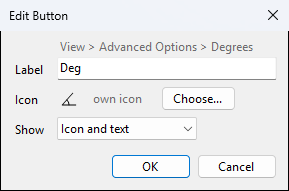
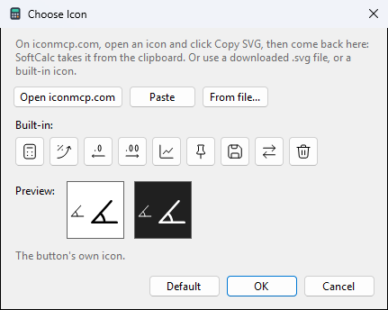

# Ribbon

The ribbon is the row of buttons under the menu bar. Every button runs
a menu command, so anything you can do from a menu can have a button.

| group | buttons |
|---|---|
| Angle | Deg, Rad, Grad |
| Output | Dec, Hex, Bin, Oct, Word size |
| Decimals | more, fewer, All |
| Mode | RPN, Prec (precision) |
| History | Clear, Save |
| Tools | Graph, Interest, On top, Conversions |

View > Show Ribbon hides or shows it. Numeric Calc never shows it.

## Customize Ribbon

View > Customize Ribbon..., or right-click the ribbon.

- **Left**: every command, in menu order. Filter by menu or search by
  name. Each function, unit pair and user function is a command.
- **Right**: the ribbon's groups and their buttons.

To change it:

- **Add** (or double-click, or Enter) puts the command after the
  selected button, or at the end of the selected group.
- **Drag** commands from the left into place; drag buttons and groups
  to move them; drag a button to the left list to remove it.
- The selected row has **Up**, **Down**, **Edit** and **Remove**
  buttons (Ctrl+Up, Ctrl+Down, F2, Delete).
- **Edit** on a button: its label, its icon, and whether it shows icon
  and text, icon only or text only. Any button can have an icon, also
  one that shows only text now, such as Deg.
- **Edit** on a group: its caption and how many columns it has. In a
  caption, `{decimals}` shows the current decimal places.
- **New group** adds a group; **Reset to default** brings back the
  ribbon above.
- **Apply** shows the change and keeps the window open; **OK** applies
  and closes; **Cancel** goes back to how it was.

A button for a user function you delete is hidden, and comes back if
you define the function again.

## Own icons

**Edit** on a button, then **Choose...** next to Icon.

- **Open iconmcp.com** opens the icon site in your browser. Open an
  icon there and click **Copy SVG**, then come back to SoftCalc: the
  icon is taken from the clipboard at once. **Paste** takes SVG that
  was copied before the window opened.
- **From file...** takes a downloaded `.svg` file.
- **Built-in** has SoftCalc's own icons.
- **Default** goes back to the command's own icon, or none.

The preview shows the icon at ribbon size and larger, on a light and a
dark ribbon. Icons are drawn in one colour, the ribbon's text colour.
SVG with text, pictures or effects can't be drawn and is refused with
the reason, such as `can't draw: text`.

The icon is kept with the ribbon layout in `settings.json`. Icons from
iconmcp.com are under the MIT licence (see File > About SoftCalc).
