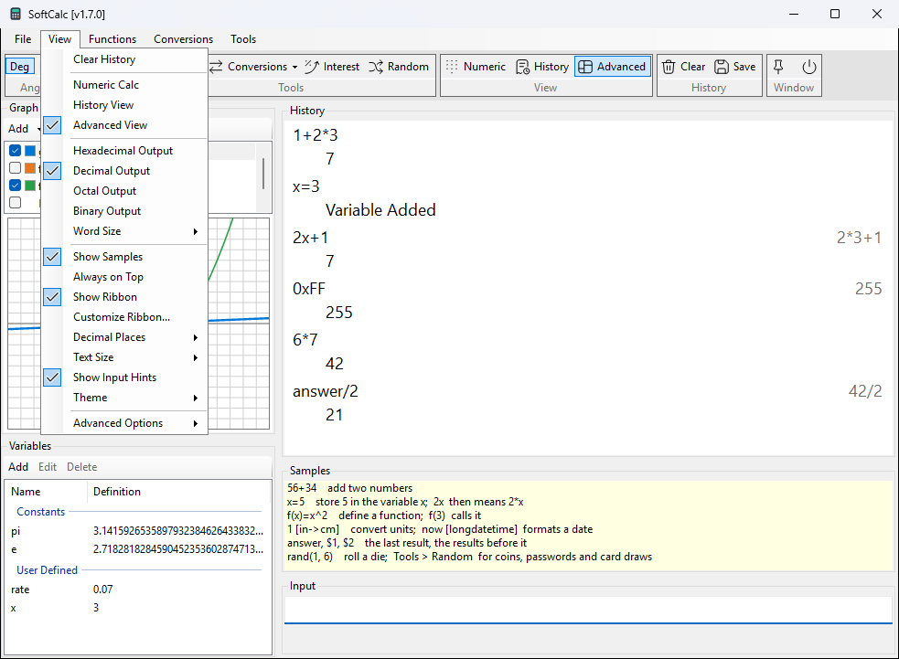
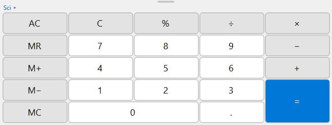
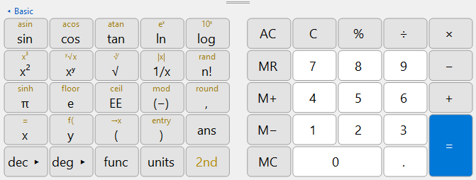

# Views and appearance

## Layouts

| view | shows |
|---|---|
| Numeric Calc | History, Input and a keypad |
| History View | History, Samples and Input |
| Advanced View | as History View, plus the Graph and Variables panels on the left (the start) |

Advanced View widens the window to the left, so History and Input stay
where they are.

## Keypad (Numeric Calc)

The keypad types into Input, so History keeps the lines as you would
type them; the keyboard works as well. Drag the bar above the keys to
make the keypad taller or shorter. Its keys follow View > Text Size.

### Basic

| key | does |
|---|---|
| **=** | calculates the line |
| **AC** | clears Input |
| **C** | takes away the last number (or the last sign): `12+345` becomes `12+` |
| **%** | types `%`, which is one hundredth: `50%` is 0.5, `200*15%` is 30 |
| **MR** | inserts `memory` |
| **M+** / **M−** | add Input (or the last result) to `memory`, or take it away |
| **MC** | sets `memory` to 0 |

The memory keys use an ordinary variable named `memory`.

### Scientific

Click **Sci ▸** at the top left for the scientific keys; **◂ Basic**
goes back. SoftCalc remembers the choice.

- **2nd** gives the next key the meaning written small above it, in
  yellow: `2nd` `sin` types `asin(`. It works for one key; press 2nd
  again to cancel.
- Functions type their name and a bracket (`sin(`); close it with `)`.
- **x²**, **xʸ**, **1/x** and **n!** type `^2`, `^`, `^(-1)` and `!`
  after what is there; **ʸ√x** types `^(1/` (add the root, then `)`),
  **∛** types `^(1/3)`.
- **EE** types `E` for powers of ten: `2`, EE, `3` is `2E3` = 2000.
  **(−)** types a minus sign for a negative number.
- **x** and **y** type the names; with 2nd, **=** and **f(** help define
  a function: `f(x)=x^2`.
- **→x** (2nd `(`) then **x** or **y** stores Input in that variable:
  `5*3`, →x, `x` gives `x=5*3`. With Input empty it stores `ans`.
- **entry** (2nd `)`) brings back the line before, like the Up key.
- **ans** types `ans`, the last result.
- **dec ▸** shows the output base and steps it: dec, hex, oct, bin.
  With a line in Input, the line is calculated in the new base and stays
  in Input, so pressing again shows it in the next base.
- **deg ▸** / **rad ▸** shows the angle unit and switches it.
- **func** opens the Functions menu, **units** the Conversions menu,
  under the key.

## Look

- **View > Theme**: System (follows Windows), Light or Dark. SoftCalc
  restarts to change it; History and definitions are kept.
- **View > Text Size**: 100% to 200% for History and Input.
  Text Size > Font... picks the font and its size at 100%.
- **View > Show Samples**: a short list of examples above Input.
- **View > Show Input Hints**: the hint line under Input.
- **View > Always on Top** (ribbon: **On top**): keep SoftCalc above
  other windows.

SoftCalc remembers the view, size, place and these settings.
