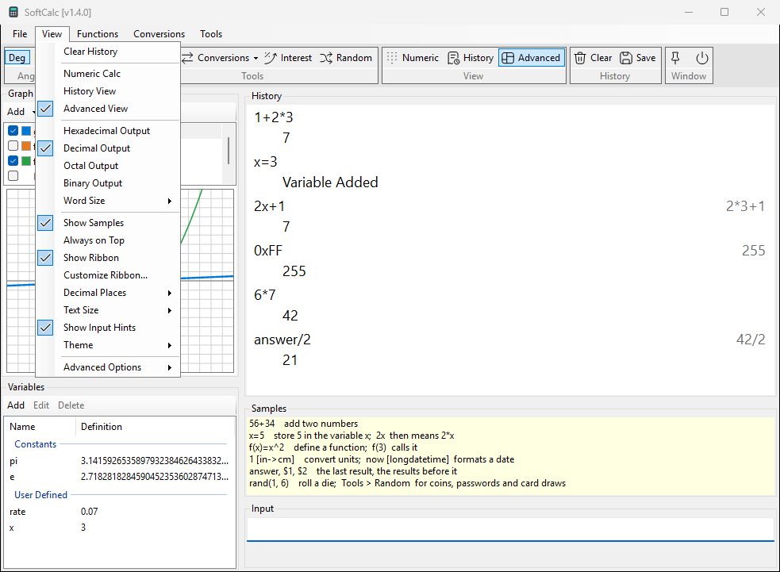

# Views and appearance

## Layouts

| view | shows |
|---|---|
| Numeric Calc | History, Input and a keypad |
| History View | History, Samples and Input |
| Advanced View | as History View, plus the Graph and Variables panels on the left (the start) |

Advanced View widens the window to the left, so History and Input stay
where they are.

## Keypad (Numeric Calc)

The keypad types into Input. **Ent** calculates, **Clr** clears Input.
The memory keys use a variable named `memory`:

- **M+** / **M-** add the Input (or the last result) to `memory`, or
  take it away;
- **MC** sets `memory` to 0;
- **MR** inserts `memory` into Input.

## Look

- **View > Theme**: System (follows Windows), Light or Dark. SoftCalc
  restarts to change it; History and definitions are kept.
- **View > Text Size**: 100% to 200% for History and Input.
  Text Size > Font... picks the font and its size at 100%.
- **View > Show Samples**: a short list of examples above Input.
- **View > Show Input Hints**: the hint line under Input.
- **View > Always on Top** (ribbon: **On top**): keep SoftCalc above
  other windows.

SoftCalc remembers the view, size, place and these settings.
