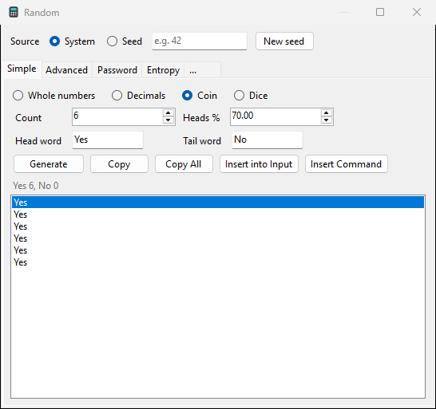
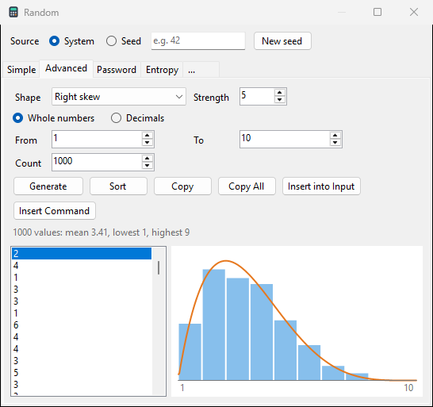
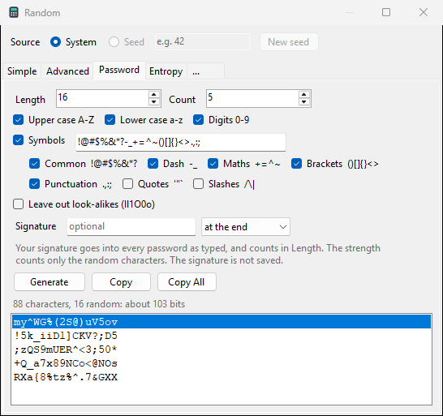
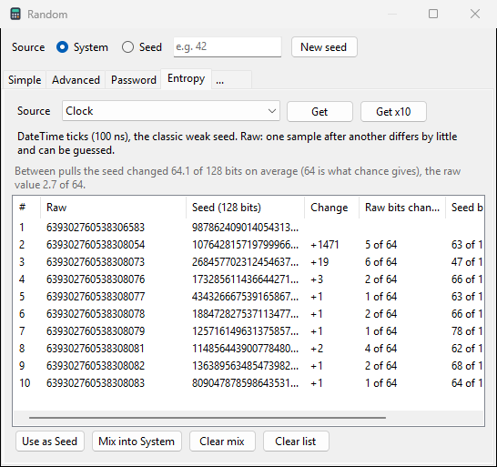
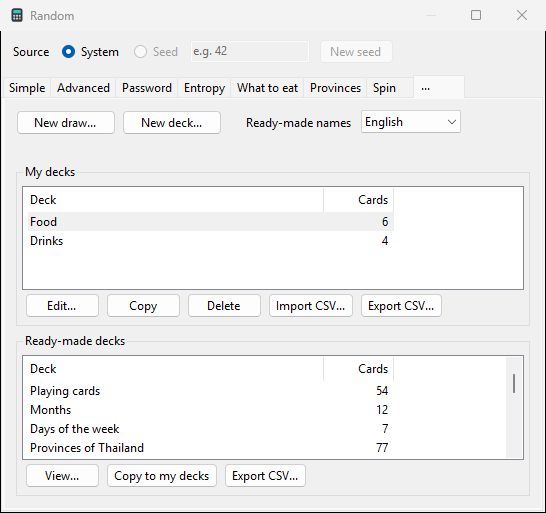
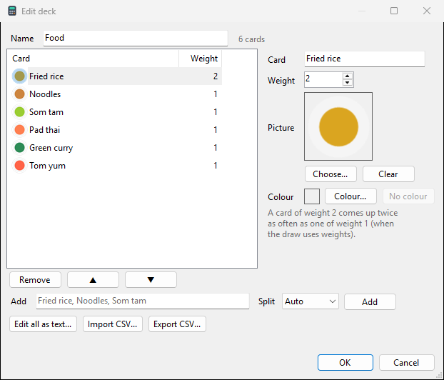
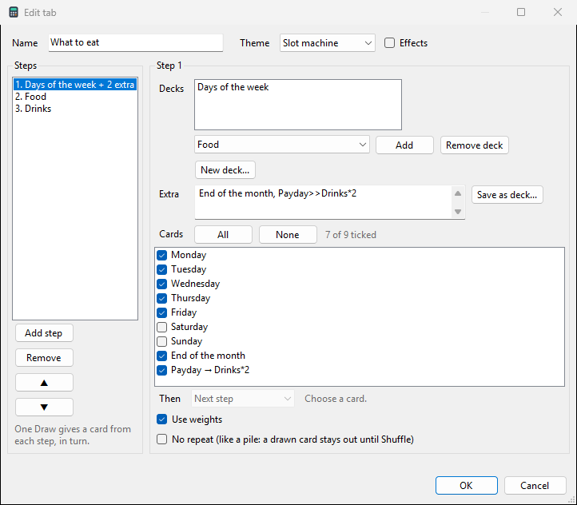
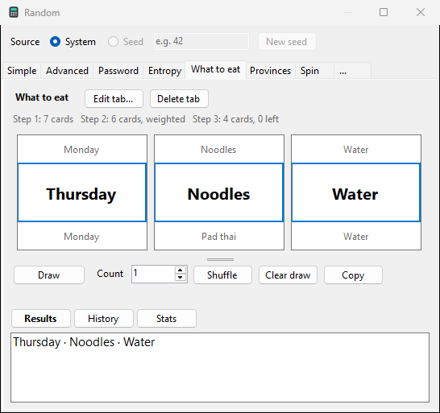
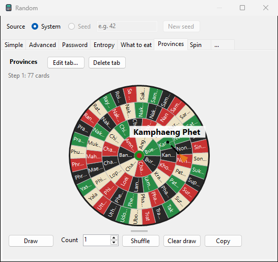
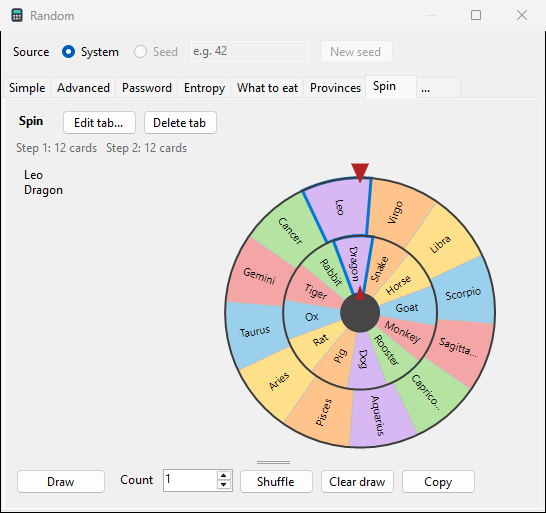

# Random

Random numbers come two ways: functions such as `rand()` in any line,
and the Random window for lists of numbers, coin flips, dice, numbers
in a shape, passwords, a look at where randomness comes from, and
draws from decks of cards of your own.

## rand() in a line

| you type | you get |
|---|---|
| `rand()` | a decimal from 0 to 1 |
| `rand(n)` | from 0 to n |
| `rand(a, b)` | from a to b |

Whole numbers give a whole number, both ends included: `rand(1, 6)` is
a dice roll. A fraction, or a number written with a point, gives a
decimal: `rand(1.0, 6)` is any value from 1 to 6. Decimals have as many
digits as the precision.

```calc
rand(1, 6)
rand(1.0, 10)
rand()
round(rand(0.0, 100), 2)
roll(n)=rand(1, n)
```

- History shows the line as typed and, on the right, the values drawn:
  `rand(1, 6)+1` shows `4+1`.
- Use Expression (click the line) brings back `rand(...)`, which draws
  again; Insert Result (Shift+click) takes the number already drawn.
- rand() is for games, samples and tests. For passwords use the
  Password tab, which uses the system's secure generator.

## Seeds

`rands(seed)` makes the draws after it repeat: the same seed gives the
same numbers, in any window and on any computer. `rands()` makes them
unpredictable again.

```calc
rands(42)       => Seed 42
rand(1, 6)      => 4
rand(1, 6)      => 4
rand(1, 6)      => 6
rands(42)       => Seed 42
rand(1, 6)      => 4
```

A seed is a number (`42`, `-7.5`). A short seed is easy to guess, so a
seed is for repeating draws, never for secrets.

## Numbers in a shape

`rand()` gives every value the same chance. These give some values
more often than others:

| you type | shape |
|---|---|
| `randbeta(a, b)` | Beta: a and b above 1 make a hump, below 1 pile up at both ends |
| `randtri(peak)` | a triangle rising to the peak |
| `randexp(rate)` | falling away (rate above 0) or climbing (below 0) |
| `randpeaks(gap)` | two humps; gap from 0 (together) to 1 (at the ends) |

Without a range they draw from 0 to 1. Add `from, to` at the end for a
range: whole numbers give whole numbers with both ends included, a
point gives decimals, as with rand().

```calc
rands(7)                              => Seed 7
randbeta(4, 4, 1, 10)                 => 8
randtri(3, 1, 10)                     => 7
randexp(4, 0, 100)                    => 41
randpeaks(0.5, 1, 10)                 => 3
round(randbeta(2, 5, 1.0, 10), 2)     => 3.17
```

`randbeta(4, 4, 1, 10)` is a bell over 1 to 10, `randbeta(2, 5, ...)`
leans to the small end, `randbeta(5, 2, ...)` to the large end and
`randbeta(0.5, 0.5, ...)` keeps away from the middle. In RPN give all
four (or three) numbers: `2 5 1 10 randbeta`.

## The Random window

Tools > Random..., or **Random** on the ribbon. It has four tabs:
Simple, Advanced, Password and Entropy, then your draw tabs and a
**...** tab that makes them. On a first run there is one draw tab to
try, **Spin**: the zodiac signs on a spin wheel.

### Source

The row above the tabs chooses where the numbers come from:

- **System**: the system's secure generator, different every time.
  The window opens with it.
- **Seed**: type a number, or press **New seed**. Simple and Advanced
  then give the same list each time for the same seed: exactly what
  `rands(seed)` and the tab's Insert Command line, typed that many
  times in Input, give at the same precision. The first seeded draw
  takes a second or so.
- **New seed** fills the box with a 128-bit number (39 digits) from
  System; on the Entropy tab it takes one from the source chosen there
  instead. Note it down to draw the same numbers again.
- The Password tab always uses System: Seed is greyed out there and
  comes back on the other tabs.
- **System + entropy (N bits)** shows while values from the Entropy
  tab are mixed in.

The seed is never saved.

### Simple



- **Whole numbers** from From to To, both included; **No repeats**
  draws each number at most once.
- **Decimals** from From to To with the decimal **Places** you choose.
- **Coin**: **Heads %** sets the chance of a head (50 is fair).
  **Head word** and **Tail word** change what is shown, such as Yes and
  No; empty, they are Head and Tail.
- **Dice** with any number of **Sides**; the sum is shown under the
  list.
- **Count** draws several at once. **Sort** puts the list in order,
  smallest first. **Copy** copies the selected lines, **Copy All**
  every line; **Insert into Input** (or a double-click) puts the
  selected numbers in Input.
- **Insert Command** puts the matching line in Input instead, to run
  (and run again) yourself:

| settings | line |
|---|---|
| whole numbers 1 to 100 | `rand(1, 100)` |
| decimals 1 to 2, 2 places | `round(rand(1.0, 2), 2)` |
| coin, 50% | `round(rand())`: 1 is a head, 0 a tail |
| coin, 70% | `floor(rand()+0.7)`: 1 with a 70% chance |
| dice, 6 sides | `rand(1, 6)` |

With a seed, type `rands(seed)` in Input first to get the window's
numbers.

### Advanced



Draws numbers that follow a shape. Pick the **Shape**; the picture on
the right draws it over From to To, and after **Generate** the
results' bars are drawn over it, so you can see they follow it. The
line under the buttons says what the shape does, and after Generate
the mean, lowest and highest value.

| shape | most values |
|---|---|
| Flat | anywhere: every value as likely |
| Bell, Narrow bell | near the middle |
| Right skew | small, with a long tail to the right |
| Left skew | large, with a long tail to the left |
| Triangle | near **Peak at** |
| U shape | near both ends |
| Two peaks | in two humps |
| Rising, Falling | the larger, or the smaller, the more often |
| Decay, Growth | very near From, or very near To |
| Custom | as Beta(**a**, **b**) gives |

- **Strength** (1 to 10, 5 to start) sets how strong the shape is: how
  narrow the bell, how far a skew leans, how deep the dip of the U, how
  far apart the two peaks, how steep a slope.
- **Whole numbers** gives each number from From to To its own slot,
  both ends included; **Decimals** with **Places**.
- **Count** goes up to 10000, enough for the bars to show the shape.
- Sort, Copy, Copy All and Insert into Input work as on Simple.
  **Insert Command** gives the function that draws the same way, at
  full precision, such as `randbeta(4, 4, 1, 10)` or
  `round(randexp(-4, 1.0, 10), 2)`.

### Password



- **Length**, **Count**, and the kinds of characters: upper case,
  lower case, digits, symbols. Each chosen kind appears at least once.
- The symbol groups tick their symbols into the list and untick them
  out of it; you can also edit the list by hand, for a site that
  allows only some symbols. Quotes and Slashes start unticked, since
  many sites refuse them.
- **Leave out look-alikes** drops `I l 1 O 0 o`.
- **Signature**: your own mark, written into every password as you
  typed it, at the end, at the start or anywhere. It counts in Length.
  The signature is never saved.
- The line under the buttons shows the strength: length times log2 of
  the number of characters to choose from, in bits, counting only the
  random characters (anyone who knows your signature knows that part).
  80 bits or more is strong.
- Double-click or **Copy** copies one password, **Copy All** every
  one. A copied password is kept out of the Windows clipboard history
  and cloud clipboard, and is wiped from the clipboard after 30
  seconds (and when SoftCalc closes).

### Entropy



Entropy is the unpredictable part a random number grows from. This tab
lets you get values from different sources side by side and see how
random they really are.

| source | what it gives |
|---|---|
| System (Windows CNG) | the output of Windows' generator (AES-CTR-DRBG, NIST SP 800-90A) |
| TPM 2.0 chip | the output of the generator in the computer's TPM chip |
| CPU timing jitter | raw: 1024 timings of a small task, which wobble |
| Clock | raw: the time in 100 ns ticks, the classic weak seed |
| GUID v4 | 122 random bits from the system generator |
| Mouse movement | raw: positions and times as you move the mouse in the box |
| Key timing | raw: the keys and the times between them as you type in the box |
| Dice rolls | raw: results of real dice you type in, 1 to 6 |
| NIST Randomness Beacon | a public 512-bit value, new every minute |
| drand (League of Entropy) | a public 256-bit value, new every 30 seconds |

- **Get** adds one row; **Get x10** adds ten (for the beacons: the
  last ten values). Mouse, Keys and Dice give one row from what you
  put in.
- Each row shows the **Raw** value, the **Seed** made from it
  (SHA-256 of the raw bytes, cut to 128 bits), how far a number moved
  since the row before (**Change**, for the clock), how many bits of
  the raw value and of the seed changed, and the estimated
  unpredictable bits (**Entropy**).
- The clock shows why a seed must come from a good source: ten pulls
  move by only a few ticks, yet their seeds change about 64 of 128
  bits, just as truly random ones do. Hashing hides the pattern; it
  adds nothing to it.
- The beacons are public, so they count as no secret bits. They are
  fetched from the internet only when you press Get, and the request
  sends nothing about you.
- **Use as Seed** puts the chosen row's seed in the Seed box.
- **Mix into System** stirs the chosen rows (all of them when none is
  chosen) into the system generator for every tab, Password too: each
  draw then hashes your entropy with fresh bytes from System, so it is
  never weaker than System alone. **Clear mix** stops it; closing the
  window does too.

### Card decks (the ... tab)



A draw picks from a pile of cards. The **...** tab holds the decks:

- **My decks**: **New deck...**, **Edit...** (or a double-click),
  **Copy**, **Delete** (it asks first), **Import CSV...** (a new deck
  named after the file) and **Export CSV...**.
- **Ready-made decks**: playing cards (four colours: spades black,
  hearts red, diamonds blue, clubs green; the two jokers start unticked
  in a draw), months, days of the week, the provinces of Thailand,
  countries by continent (the UN members, Palestine, Taiwan and the
  Vatican; also all of them), twelve colours, the zodiac signs and the
  animal years. **Ready-made names** shows them in English or Thai.
  They cannot be edited: **View...** shows the cards, **Copy to my
  decks** makes a deck you can change, in the language shown.



- Each card has a name, a **Weight**, a **Picture** and a **Colour**.
  A card of weight 2 comes up twice as often as one of weight 1, when
  the draw uses weights. A picture is shrunk to 128 pixels and kept in
  the data folder, so the original file can move.
- **Colour...** gives the chosen cards a colour (several at once),
  **No colour** takes it off. The dartboard and spin wheel fill a
  card's part with it, the slot machine shows a strip, and a card
  without a picture shows its colour in the list.
- **Add** takes several cards at once: one per line, or split by
  commas, or by spaces. With **Split** on Auto it uses lines if there
  is a line break, else commas if there is a comma, else spaces; a
  name with a space in it needs lines or commas. A weight can follow a
  bar (`Fried rice|2`), and a run of numbers makes a card for each
  (see *Extra cards* below). A condition (`>>`) belongs to a draw tab,
  so Add leaves it out and says so.
- **Edit all as text...** shows every card on a line, with the weight
  after a bar: `Fried rice | 2`.
- **Import CSV...** adds cards from a CSV or text file: a name, then a
  weight, the path of a picture and a colour if you like
  (`name,weight,image,color`, the colour as `#RRGGBB`). Thai text from
  Excel reads correctly. **Export CSV...** writes the same columns, for
  Excel too.

### Draw tabs

**New draw...** asks for the tab's name (Custom random to start), its
theme and its steps:



- Each step picks one card. Add any decks to its pile, and type
  **Extra** cards that belong to this draw only (they are not saved as
  a deck): Days of the week with `End of the month, Payday` makes 9
  cards. Untick a card to leave it out, such as Saturday and Sunday.
- **Use weights**: the cards' weights count; off, every card has the
  same chance. **No repeat**: like a real pile, a drawn card stays out
  until you press Shuffle.
- One Draw gives a line with a card from each step in turn, such as
  `Friday · Fried rice · Iced tea`.
- **Save as deck...** makes the Extra cards a deck of your own (the
  deck editor opens to name it); the step then uses that deck, with
  the cards' conditions, ticks and counts.

#### Extra cards

| you type | you get |
|---|---|
| `Fried rice` | a card |
| `Fried rice\|2` | a card of weight 2 |
| `[1,100]` | a card for each number from 1 to 100 |
| `[0,1,0.25]` | 0.00, 0.25, 0.50, 0.75, 1.00 (the third number is the step) |
| `[10,1,3]` | 10, 7, 4, 1 |
| `[01,31]` | 01, 02 ... 31: leading zeros and decimals stay as typed |
| `Fish [1,3] each` | Fish 1 each, Fish 2 each, Fish 3 each |

A run of numbers takes the weight and condition after it to every
card: `[1,6]>>stop|2`. Only the first run in a card counts; one that is
written wrong stays as a card's name.

#### Conditions

A condition after `>>` says what happens once the card is drawn:

| you type | then |
|---|---|
| `Run` (none) or `Run>>next` | the next step, as usual |
| `Rice soup>>stop` | the line ends here |
| `Lunch>>step 3` | skip to step 3 (only a later step) |
| `Gym>>Gym` | draw a card from the deck named Gym too, then the next step |
| `Gym>>Gym*2` | two different cards from Gym |
| `Gym>>Gym,stop` | a card from Gym, then the line ends |
| `Rice soup>>stop\|2` | a condition and a weight (`Rice soup\|2>>stop` works too) |

For a card from a deck, choose it in the card list and set the **Then**
row: Next step, Stop the line, Skip to step, or Draw from deck with how
many cards and **then stop**. The list shows the condition after the
card, such as `Gym → Gym`. Conditions belong to the draw tab, not the
deck. A deck named like a word above is written `deck:stop`. OK checks
every condition and names a deck or step that is not there.

```
Step 1:  Run, Badminton, Gym>>Gym|2, Swim>>stop
Step 2:  30 minutes, 45 minutes, 1 hour
```

gives lines such as `Run · 45 minutes`, `Gym → Yoga · 1 hour` and
`Swim`. A deck drawn by a condition goes one level only (its cards'
own conditions are not used), follows the step's weights and No
repeat, and has its own rows in Stats, such as `1 → Gym`.

#### Drawing



- **Draw** draws **Count** lines. The **Theme** is set in **Edit
  tab...**:

| theme | the effect |
|---|---|
| List | the lines roll in Results, slowing down |
| Slot machine | a reel for each card, stopping one by one from the left; with Count 2 to 5 every line plays, a row each (side by side when each line has one card); new tabs start here |
| Dartboard | a board for each card, each card's part as big as its chance; the board spins 2 to 4 seconds and the dart is thrown 1 to 3 seconds in, so it may land while the board still turns and turn with it |
| Spin wheel | up to three rings a wheel, a card each, turning in turn the other way and stopping from the outside in; the card under the marker at the top (and the one on the hub) is drawn; more cards spin more wheels |

- With **Effects** on, Results and History wait until the reels stop or
  the dart lands, so nothing gives the result away. The cards are drawn
  first, so the effect never changes them; a click skips it.
- A dartboard with more than 36 cards gets rings, up to four: every
  card's part keeps its share of the board, the heaviest cards go in
  the middle, and the parts stay 10 degrees wide or more where they can
  (77 cards: 7, 15, 23 and 32 from the middle out).
- Drag the bar under the theme to make it taller (Results gets
  shorter); the tab keeps the height.
- **Shuffle** puts the drawn cards back in the No repeat piles and
  mixes where the cards sit on the dartboard and spin wheel; this is
  for show only, draws and seeds do not use it. The line under the
  name shows each step's cards and how many are left.
- **Results** shows the last Draw, **History** every line with its
  date and time (newest first, the last 1000), **Stats** how often each
  card came up, its share, and the share its weight gives.
- **Clear draw** empties Results; History and Stats stay. **Clear
  history...** (on the History tab) and **Clear stats...** (on the Stats
  tab) ask first, then empty that list. **Copy** copies the chosen lines
  (all when none is chosen).
- Right-click Results, History or Stats for Copy, Copy all and the
  Clear item of that list.
- **Edit tab...** changes the name, theme, Effects and steps; **Delete
  tab** removes the tab with its History and Stats (its decks stay).
- With **Seed** in the Source row, the same seed and the same piles
  give the same cards.





Decks and draw tabs, with their History and Stats, are kept in
`cards.json` (and pictures in `cards\`) in the data folder. Nothing
drawn goes to the calculator's History.

The other tabs keep nothing they drew: their lists are cleared when
the window closes. The window keeps only its settings, never a seed,
a signature or a password.
