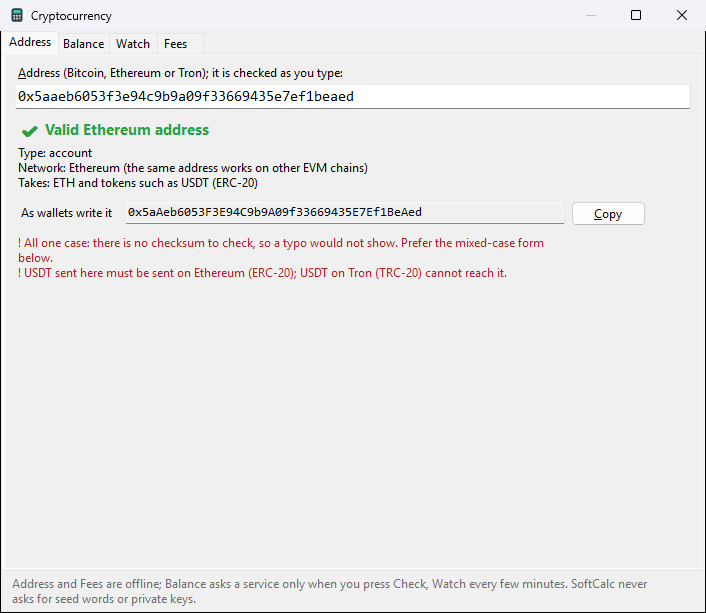
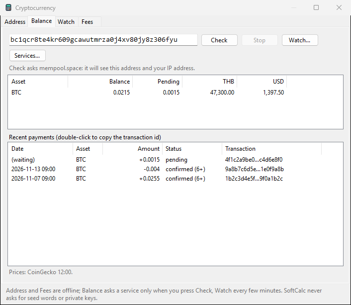
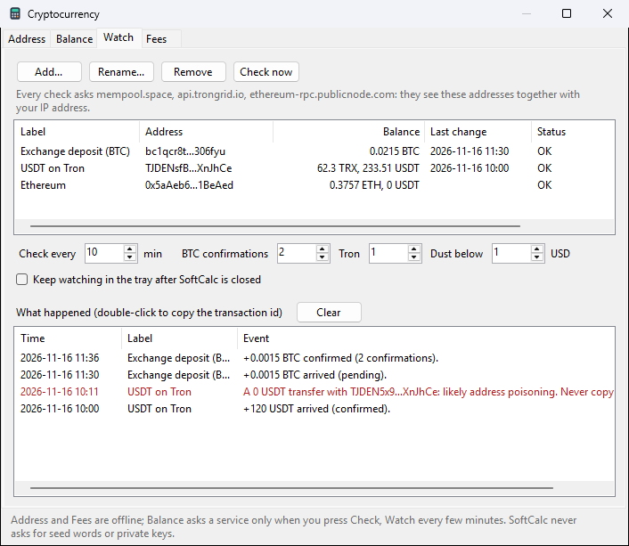

# Cryptocurrency

<!-- desktop -->
SoftCalc works out coin amounts and fees, checks that an address is
written correctly, and shows balances of Bitcoin, Ethereum and Tron
addresses. It only looks: it never asks for seed words or private keys,
cannot send coins, and refuses text that looks like a secret.
<!-- /desktop -->

<!-- web -->
SoftCalc works out coin amounts and converts coins to money at today's
price. It never asks for seed words or private keys and cannot send
coins.
<!-- /web -->

## Coin units

Coins convert like other units:

```calc
1 [btc->sat]          => 100000000
2500 [sat->btc]       => 0.000025
21000*25 [gwei->eth]  => 0.000525
1 [eth->gwei]         => 1000000000
5 [trx->sun]          => 5000000
```

| coin | units |
|---|---|
| Bitcoin | `btc`, `sat` (0.00000001 btc) |
| Ethereum | `eth`, `gwei` (0.000000001 eth), `wei` (10^-18 eth) |
| Tron | `trx`, `sun` (0.000001 trx) |

Conversions > Cryptocurrency > Bitcoin, Ethereum, Tron and Tether put these
tags in Input: each unit goes to its coin's other units, the other coins
or the common currencies.

## Prices

A coin to a currency, or one coin to another, uses today's price:

```calc
0.01 [btc->thb]
100 [usdt->thb]
50000 [sat->usd]
21000*25 [gwei->thb]
1100000 [thb->btc]
1 [btc->eth]
```

- Prices of BTC, ETH, TRX and USDT come from CoinGecko, in the same
  currencies as the ECB rates. The result line shows when, faint:
  `CoinGecko 14:05`.
- SoftCalc asks only when a line needs a price, and keeps the answer
  for 5 minutes. The request names coins and currencies, never an
  address.
- Without the internet the last prices are used and the note ends in
  `, offline`.
- One coin to another goes through the US dollar.
- `usdt` is a price only; it has no small unit.

<!-- desktop -->
## The Cryptocurrency window

Tools > Cryptocurrency... has four tabs. Address and Fees work offline;
Balance asks a service when you press Check; Watch asks every few
minutes for the addresses you list.

### Address



Paste an address: it is checked as you type.

- **Bitcoin**: `1...`, `3...`, `bc1q...`, `bc1p...` (Taproot), and test
  network addresses. The checksum catches a wrong or missing character.
- **Ethereum**: `0x` and 40 hex digits. Mixed case is a checksum
  (EIP-55) and is checked; all one case has no checksum, so a typo would
  not show: SoftCalc warns and gives the mixed-case form.
- **Tron**: `T...`, with its checksum.
- **Bitcoin xpub / ypub / zpub**: recognised as a wallet's public key.
- Each check says which coins the address takes. USDT exists on several
  networks: USDT sent on Ethereum (ERC-20) cannot reach a Tron address,
  nor the other way round.
- **As wallets write it** shows the address in its usual form; Copy puts
  it on the clipboard.
- Seed words and private keys are refused: the box is emptied at once
  and nothing is kept.

### Balance



Type an address (or an xpub) and press Check. The line under the box
says which service will see it.

| address | shows | service |
|---|---|---|
| Bitcoin | balance, pending, recent payments with confirmations | mempool.space |
| xpub / ypub / zpub | the whole wallet's balance and recent payments | mempool.space |
| Ethereum | ETH and USDT (ERC-20); no payment history | PublicNode |
| Tron | TRX and USDT (TRC-20), recent transfers | TronGrid |

- Values in THB and USD use the same prices as the lines above.
- Double-click a payment to copy its transaction id.
- **xpub / ypub / zpub**: SoftCalc makes the wallet's addresses, receive
  and change, and asks about each until 20 unused ones in a row. The
  letter picks the address type (x: `1...`, y: `3...`, z: `bc1q...`); a
  Taproot wallet's xpub needs Taproot chosen in the list. Payments come
  from the 10 newest addresses used.
- Public services limit how fast they answer. SoftCalc asks a second
  apart and waits when a service says it is busy; a wallet with many
  addresses takes a minute or more.

**Services...** sets the three services, for example your own node:

| network | works | does not work |
|---|---|---|
| Bitcoin | an Esplora API: the mempool app on Umbrel (`http://umbrel.local:3006/api`), blockstream.info | Bitcoin Core alone (no address index) |
| Ethereum | any JSON-RPC node (`http://host:8545`) | |
| Tron | TronGrid's API | a plain Tron node's HTTP API |

A service on your own computer or home network is asked without the
one-second gap. Defaults puts the public services back.

### Watch



Watch keeps an eye on addresses, such as an exchange's deposit address,
and tells you when something happens.

- **Add...** asks for a label and the address (one address; a whole
  wallet by xpub is not watched). In the Balance tab, **Watch...** adds
  the address in its box.
- SoftCalc checks every 10 minutes while it runs, and every minute while
  an incoming payment waits for its confirmations. The first check only
  notes what is there.
- News shows as a notification from SoftCalc's icon by the clock, and in
  the list at the bottom:

| news | when |
|---|---|
| arrived | a new incoming payment (pending, or with its confirmations) |
| confirmed | it reached the confirmations set (Bitcoin 2, Tron 1) |
| sent | a new outgoing payment |
| balance | an Ethereum balance moved (no history there) |
| warning (red) | a payment that looks like a trick, below |

- **Warnings**: a transfer of 0, an incoming payment under the dust
  value (1 USD), or an address that copies the first and last characters
  of one you know. This is *address poisoning*: someone hopes you copy
  their look-alike address from the history next time. Always copy an
  address from the place that gave it to you, never from the history,
  and check more than its ends. Leave dust unspent.
- **Keep watching in the tray after SoftCalc is closed**: closing the
  window leaves SoftCalc by the clock, still watching. Double-click the
  icon to open it; right-click for Check now and Exit. File > Exit
  always closes SoftCalc.
- The list is kept in `crypto.json` in the data folder: addresses and
  labels, nothing secret.

### Fees

Bitcoin: the size in vB times sat/vB; a payment from one SegWit input to
two outputs is about 141 vB. Ethereum: gas times gwei; sending ETH takes
21,000 gas, a token such as USDT about 65,000. **Insert** puts the sum in
Input, such as `141*10 [sat->btc]`.

## Privacy

- Address and Fees never use the internet.
- Balance and Watch send each address, with your IP address, to the
  service named on the tab. That service can link the addresses you
  check to each other and to you; an xpub shows it every address of the
  wallet, past and future. Your own node avoids this.
- Price requests carry no address.
<!-- /desktop -->

<!-- web -->
## Privacy

- Price requests name coins and currencies, never an address. CoinGecko
  sees your IP address, as any website does.
<!-- /web -->
