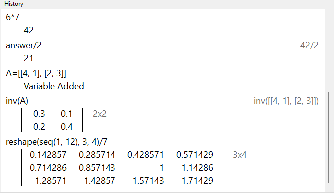

# Lists and matrices

A **list** is numbers in square brackets, a **matrix** is rows in
square brackets, each row a list of the same length:

```calc
[1, 2, 3]                     => [1, 2, 3]
[[1, 2], [3, 4]]              => [[1, 2], [3, 4]]
[1+1, sqrt(9), 2^3]           => [2, 3, 8]
```

Items may be any expression. A list, a matrix or a result holding one
can go in a variable, `$n`, `answer` and the `.pcf` file, like a number.
Lists and matrices are not available in RPN.

## [ ] for lists, [ ] for tags

Square brackets also hold conversion tags (`1 [ft->in]`). Which one a
`[` is depends on what comes before it:

- right after a value (a number, a name, `)` or `]`) it is a **tag**:
  `5 [ft->in]`, `x [c->f]`;
- where a value starts (at the start, or after an operator, `(`, `,`
  or `=`) it is a **list**: `[1, 2]`, `2*[1, 2]`, `A=[[1, 2], [3, 4]]`.

So write `*` before a list, and use `at()` for a cell:

```calc
2*[1, 2]                      => [2, 4]
2[1, 2]                       => ERROR:Write * before a list (2*[1, 2]); at(A, 1) takes a cell
```

The hint line under Input says which one an open `[` is.

## Arithmetic

A list and a number work cell by cell, with any operator:

```calc
2*[1, 2, 3]                   => [2, 4, 6]
[1, 2, 3]+10                  => [11, 12, 13]
[1, 2, 3]^2                   => [1, 4, 9]
[1, 2]+[3, 4]                 => [4, 6]
```

Two matrices (or lists) of one size add and subtract cell by cell; `*`
is the matrix product; `^` takes a whole power, `^-1` is the inverse:

```calc
A=[[4, 1], [2, 3]]            => Variable Added
B=[[1, 0], [2, 1]]            => Variable Added
A+B                           => [[5, 1], [4, 4]]
A*B                           => [[6, 1], [8, 3]]
A^2                           => [[18, 7], [14, 11]]
A^-1                          => [[0.3, -0.1], [-0.2, 0.4]]
A^0                           => [[1, 0], [0, 1]]
```

A list beside a matrix fits as a row on the left and as a column on
the right, and the answer is a list:

```calc
A*[1, 1]                      => [5, 5]
[1, 1]*A                      => [6, 4]
```

There is no `A/B` or `2/A`: write `A*inv(B)`. Two lists do not multiply
with `*`; use `dot()`.

## Making lists and matrices

| you type | you get |
|---|---|
| `identity(n)` | the n x n identity matrix |
| `zeros(n)`, `ones(n)` | a list of n zeros or ones |
| `zeros(rows, cols)`, `ones(rows, cols)` | a matrix of zeros or ones |
| `fill(n, value)`, `fill(rows, cols, value)` | a list or a matrix of one value |
| `fill(rows, cols, list)` | the list as every row |
| `diag(list)` | a matrix with the list down its diagonal |
| `seq(from, to, [step])` | from, from+step, ... up to to |
| `reshape(list, rows, cols)` | the numbers, row by row, as a matrix |
| `randm(rows, cols, [from, to])` | random cells, as `rand()` draws them |

```calc
identity(3)                   => [[1, 0, 0], [0, 1, 0], [0, 0, 1]]
zeros(2, 3)                   => [[0, 0, 0], [0, 0, 0]]
fill(2, 3, 7)                 => [[7, 7, 7], [7, 7, 7]]
fill(2, 3, [1, 2, 3])         => [[1, 2, 3], [1, 2, 3]]
diag([1, 2, 3])               => [[1, 0, 0], [0, 2, 0], [0, 0, 3]]
seq(1, 5)                     => [1, 2, 3, 4, 5]
seq(0, 1, 0.25)               => [0, 0.25, 0.5, 0.75, 1]
seq(10, 1, 3)                 => [10, 7, 4, 1]
reshape(seq(1, 6), 2, 3)      => [[1, 2, 3], [4, 5, 6]]
```

`seq` steps toward `to` whatever the sign of the step, like a run of
numbers in a deck (`[10,1,3]` in the Random window). In a calculation
`[1, 100]` is a list of two numbers; the run 1 to 100 is `seq(1, 100)`.

### Random lists and matrices

`randm` draws every cell as `rand()` does. In `fill`, a value that
calls `rand`, a shaped rand or `card` is **drawn again for every cell**
(for every row when it gives a list); the hint line says so while you
type it. `rands(seed)` makes them repeat:

```calc
rands(3)                      => Seed 3
randm(2, 3, 1, 6)             => [[4, 5, 3], [6, 2, 1]]
fill(2, 4, rand(1, 6))        => [[6, 3, 2, 4], [5, 6, 5, 1]]
fill(3, round(randbeta(4, 4, 1, 10)))
reshape(card("Dice", 6, 1), 2, 3)
```

The last line deals a deck named Dice with cards 1 to 6 into a 2 x 3
matrix, no card twice.

## Size and cells

Cells count from 1: row first, then column.

```calc
rows(A)                       => 2
cols([1, 2, 3])               => 3
len(A)                        => 4
at(A, 2, 1)                   => 2
at([5, 6, 7], 3)              => 7
row(A, 2)                     => [2, 3]
col(A, 1)                     => [4, 2]
```

`len` counts every cell; `rows` of a list is 1.

## Linear algebra

```calc
transpose(A)                  => [[4, 2], [1, 3]]
det(A)                        => 10
inv(A)                        => [[0.3, -0.1], [-0.2, 0.4]]
trace(A)                      => 7
rank([[1, 2], [2, 4]])        => 1
solve(A, [9, 8])              => [1.9, 1.4]
eig(A)                        => [5, 2]
dot([1, 2, 3], [4, 5, 6])     => 32
cross([1, 0, 0], [0, 1, 0])   => [0, 0, 1]
norm([3, 4])                  => 5
```

- `solve(A, b)` gives x with `A*x = b`; b is a list (the answer is a
  list) or a matrix of columns.
- `eig` gives the eigenvalues, largest real part first; they may be
  complex (`eig([[0, -1], [1, 0]])` is `[1i, -1i]`).
- `norm` of a list is its length; of a matrix, the same over every cell.
- `det`, `inv`, `solve` and `^` take at most 50 x 50, `eig` 20 x 20.

More (MathWorld): [Transpose](https://mathworld.wolfram.com/Transpose.html),
[Determinant](https://mathworld.wolfram.com/Determinant.html), [Matrix Inverse](https://mathworld.wolfram.com/MatrixInverse.html),
[Matrix Trace](https://mathworld.wolfram.com/MatrixTrace.html), [Matrix Rank](https://mathworld.wolfram.com/MatrixRank.html),
[Linear System of Equations](https://mathworld.wolfram.com/LinearSystemofEquations.html),
[Eigenvalue](https://mathworld.wolfram.com/Eigenvalue.html), [Dot Product](https://mathworld.wolfram.com/DotProduct.html),
[Cross Product](https://mathworld.wolfram.com/CrossProduct.html), [Vector Norm](https://mathworld.wolfram.com/VectorNorm.html),
[Frobenius Norm](https://mathworld.wolfram.com/FrobeniusNorm.html) (norm of a matrix).


## Statistics and lists

These take numbers and lists mixed, and use every cell; the functions
menu has them under Statistics:

```calc
sum([1, 2, 3], 4)             => 10
mean([2, 4, 9])               => 5
median([3, 1, 2, 10])         => 2.5
prod([1, 2, 3, 4])            => 24
min([3, 1, 2])                => 1
max(3, 9, 2)                  => 9
count([4, 5], 6)              => 3
stdevp([2, 4, 4, 4, 5, 5, 7, 9]) => 2
variancep([1, 2, 3, 4])       => 1.25
variance(1, 2, 3, 4)          => 1.6666666666666666666666666666667
```

`stdev` and `variance` are for a sample (dividing by n - 1, as Excel's
STDEV.S); `stdevp` and `variancep` for a whole population (n).

These take one list:

```calc
sort([3, 1, 2])               => [1, 2, 3]
reverse([1, 2, 3])            => [3, 2, 1]
cumsum([1, 2, 3, 4])          => [1, 3, 6, 10]
```

More (NIST/SEMATECH e-Handbook of Statistical Methods): mean and
median in [Measures of Location](https://www.itl.nist.gov/div898/handbook/eda/section3/eda351.htm); variance and standard
deviation in [Measures of Scale](https://www.itl.nist.gov/div898/handbook/eda/section3/eda356.htm).


## Functions and conversions on every cell

A function of one number, and a unit, currency or coin tag, work on
each cell:

```calc
sqrt([4, 9, 16])              => [2, 3, 4]
round([1.234, 5.678], 1)      => [1.2, 5.7]
[1, 2] [m->cm]                => [100, 200]
[[0, 100], [37, -40]] [c->f]  => [[32, 212], [98.6, -40]]
```

Date formats and time zones take one date, not a list.

## In History

A matrix result shows as a table, its size beside it. While Decimal
Places is All, the table rounds cells to 6 digits; the result itself
keeps every digit, and that is what a click, Insert Result, `$n` and
Copy Result use. At most 10 rows and 10 columns show; `…` and `⋮` mark
the rest. A list stays on one line.

<!-- desktop -->


Right-click a matrix result for **Copy as Table**: every cell in full,
tab-separated, ready to paste into a spreadsheet. In Variables, point
at a matrix variable to see its table. At a large text size the table
shows fewer than 10 rows (a History line is at most 255 pixels high).
<!-- /desktop -->

<!-- web -->
A wide table scrolls sideways. Hold a matrix result for **Copy as
table**: every cell in full, tab-separated, ready to paste into a
spreadsheet.
<!-- /web -->

## Accuracy

A matrix whose det is 0 has no inverse. Because a decimal such as
`0.316` is not exact in binary, a det smaller than the shown precision
allows counts as 0:

```calc
det([[0.316, 1.2], [0.632, 2.4]])   => 0
inv([[1, 2], [2, 4]])         => ERROR:The matrix has no inverse (its det is 0)
```

A matrix close to det 0 shows every digit, with a note beside it such
as `about 10 of 32 digits may be off`. *Error messages* says more, and
lists the errors of lists and matrices.

## The functions, by group

<!-- desktop -->
Functions > Matrix has the ten used most on top (`det` `inv` `solve`
`transpose` `eig` `identity` `fill` `seq` `sum` `mean`), then a submenu
for each group below; the statistics are in Functions > Statistics.
<!-- /desktop -->
<!-- web -->
func > Matrix has the ten used most on top (`det` `inv` `solve`
`transpose` `eig` `identity` `fill` `seq` `sum` `mean`), then a line
for each group below (`Build ›`); the statistics are in func >
Statistics.
<!-- /web -->

| group | functions |
|---|---|
| Build | `identity` `zeros` `ones` `diag` `fill` `seq` `reshape` `randm` |
| Size and pick | `rows` `cols` `len` `at` `row` `col` |
| Linear algebra | `transpose` `det` `inv` `trace` `rank` `solve` `eig` `dot` `cross` `norm` |
| Arrange | `sort` `reverse` `cumsum` |
| Statistics (its own menu) | `sum` `prod` `min` `max` `count` `mean` `median` `stdev` `stdevp` `variance` `variancep` |
